# 叠云 Agent 架构手册

> **产品名**：叠云 Agent（npm 包名 `dieyunagent`）
> **文档类型**：架构说明
> **关联文档**：[`DESIGN.md`](./DESIGN.md)（设计原理）· [`AGENT-STRATEGY.md`](./AGENT-STRATEGY.md)（Agent 策略分层 · 开放设计）· [`MEMORY.md`](./MEMORY.md)（记忆）· [`DEVELOPMENT.md`](./DEVELOPMENT.md)（开发发版）

---

## 目录

1. [概述](#1-概述)
2. [总体架构](#2-总体架构)
3. [进程与启动链](#3-进程与启动链)
4. [本地 Gateway](#4-本地-gateway)
5. [Agent 执行](#5-agent-执行)
6. [dieyun-core（Rust Sidecar）](#6-dieyun-corerust-sidecar)
7. [记忆系统](#7-记忆系统)
8. [渲染进程 UI 模块](#8-渲染进程-ui-模块)
9. [技能、MCP 与插件](#9-技能mcp-与插件)
10. [SSH 与远程工作空间](#10-ssh-与远程工作空间)
11. [浏览器自动化](#11-浏览器自动化)
12. [定时任务（Plans）](#12-定时任务plans)
13. [自动更新与打包](#14-自动更新与打包)
15. [代码库索引](#15-代码库索引)
16. [附录：目录速查与数据路径](#16-附录目录速查与数据路径)

---

## 1. 概述

叠云 Agent 是一个 **本地优先的桌面 AI Agent**：

- 用户在 Electron 窗口里对话；
- 模型可调用本机工具（读写文件、执行命令、查库、联网等）；
- 复杂任务走 **规划师 + 多子 Agent + Git Worktree 隔离**；
- 对话、技能、计划任务围绕同一套「模型设置 + Gateway」运转。

**一句话架构**：Electron 主进程负责「系统能力与安全边界 + Rust sidecar 编排」，渲染进程负责「Agent UI 与 Gateway 客户端」，本地 Gateway 用 WebSocket + RPC 桥接工具与记忆；复杂 Agent/Planner 循环在 **`dieyun-core`（Rust）**，LLM 与工具执行由 **Node 主进程** 委托。

### 1.1 核心设计取舍

| 话题 | 选择 | 原因 |
|------|------|------|
| Gateway 协议 | 自研 WebSocket RPC | 轻量、与 Electron 解耦 |
| 智能主路径 | 渲染进程 UI + Main/Rust 循环 | UI 迭代快；状态机在 Rust |
| 路径安全 | 白名单 | 用户选工作空间即授权 |
| 复杂任务 | Planner + worktree | 并行与隔离 |
| 简单任务 | 单 Agent Rust loop | 省规划延迟 |
| 记忆存储 | Rust SQLite（唯一写入路径） | 一致性与性能 |
| 定时任务 | 单次 LLM，无工具循环 | 可预测、低成本 |

### 1.2 安全模型

- `contextIsolation: true`，`nodeIntegration: false`——页面 JS 不能直接 `require`。
- 特权操作必须经 **preload IPC** 或 **Gateway RPC**。
- Gateway 只监听 **127.0.0.1**，带 **token 鉴权**。
- 文件/命令能力靠 **路径白名单 + 权限开关**。

---

## 2. 总体架构

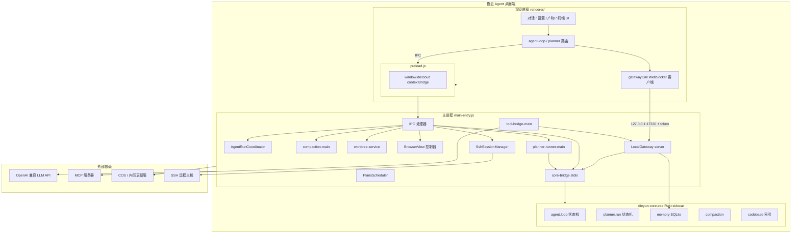

### 2.1 三层职责

| 层 | 目录 | 职责 |
|----|------|------|
| **Renderer** | `src/renderer/` | 聊天气泡、输入、Plan 进度、Gateway 客户端、工具 UI 委托 |
| **Main** | `src/main-entry.js`、`src/agent/` | 窗口/托盘、IPC、Worktree、Rust 桥、计划调度、工具执行（LLM HTTP 已在 core，见 [`LLM-RPC.md`](./LLM-RPC.md)） |
| **Gateway** | `src/gateway/` | 工具 RPC、权限、路径白名单、桥接 Rust memory |
| **Rust** | `crates/dieyun-core/` | Agent/Planner 状态机、**LLM 客户端与流式解析**、上下文折叠（transcript 唯一写者）、SQLite 记忆、向量（本地优先）、索引 |

---

## 3. 进程与启动链

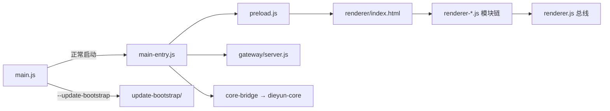

| 文件 | 作用 |
|------|------|
| `src/main.js` | 极薄路由：正常应用或更新引导 |
| `src/main-entry.js` | Electron 应用主体：窗口、托盘、IPC、Gateway、更新、计划 |
| `src/preload.js` | `contextBridge` 暴露 `window.diecloud` |
| `src/renderer/index.html` | UI 壳，按序加载各 renderer 模块 |
| `src/renderer/renderer.js` | UI 总线与 Gateway 客户端入口 |

### 3.1 Rust 能力开关（环境变量）

| 变量 | 含义 |
|------|------|
| `DIEYUN_CORE=0` | 禁用 sidecar（Agent/Plan 不可用） |
| `DIEYUN_CORE_BIN` | 开发时指定 debug 二进制路径 |

---

## 4. 本地 Gateway

实现：`src/gateway/server.js` + `src/gateway/rpc.js`

### 4.1 连接协议（v1）

1. WebSocket 连接 `127.0.0.1:17330`（可用 `DIECLOUD_GATEWAY_PORT` 改端口）。
2. 首包 `{ type: 'auth', token }`，token 存于 `%APPDATA%/dieyunagent/gateway-token.txt`。
3. 之后 `{ type: 'call', id, method, params }` → `{ type: 'result', id, ok, data|error }`。

渲染进程封装：`gatewayCall(method, params)`（`renderer-gateway.js`）。

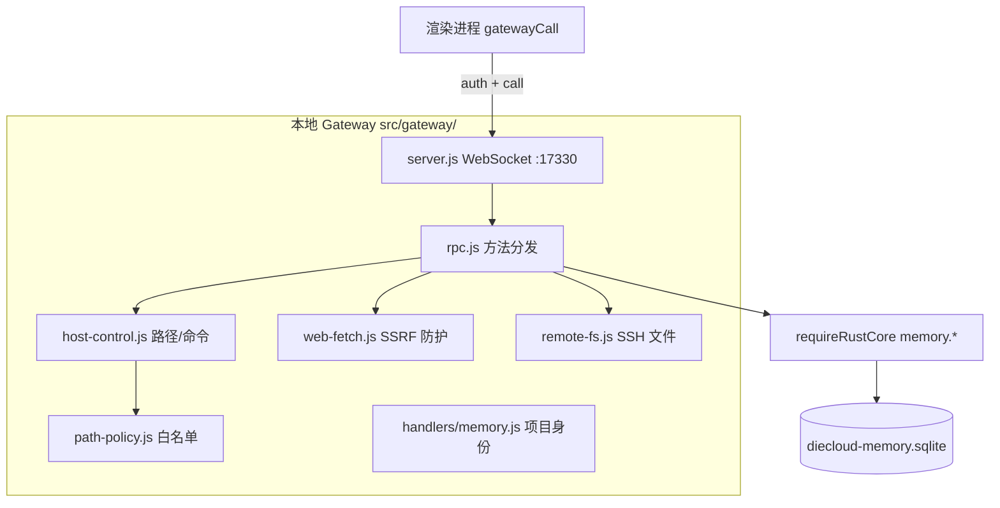

### 4.2 RPC 命名空间

| 前缀 | 职责 |
|------|------|
| `permissions.*` | 读/写/执行/联网开关 |
| `memory.*` | 会话、消息、长期记忆、每会话工作空间 |
| `compaction.*` | 上下文 token 估算与压缩 |
| `fs.*` | 白名单内读写列目录 |
| `host.*` | Shell、打开 URL |
| `web.*` | HTTP fetch、搜索（SSRF 防护） |

### 4.3 工作空间（两层，勿混）

1. **Gateway 全局 `workspaceRoot`**（`userData/workspace.json`）——决定 `fs_*` / `host_exec` 的默认 cwd。
2. **每会话 `workspace_path`**（SQLite `sessions` 表）——切换历史对话时 `applySessionWorkspace()` 写回 Gateway。

**读根**：gateway-readable、userData、`~/.dieyun`、技能目录、工作空间等。
**写根**：更窄——gateway-readable、`~/.dieyun/skills`、当前工作空间。

---

## 5. Agent 执行

入口：`renderer-agent-loop.js` 的 `runAgentCompletion()`。

> 发送前 `taskTier` 只走结构信号（路径/选区/@Codebase），护栏数字在 `agent-limits`。详见 [AGENT-STRATEGY.md](./AGENT-STRATEGY.md)。

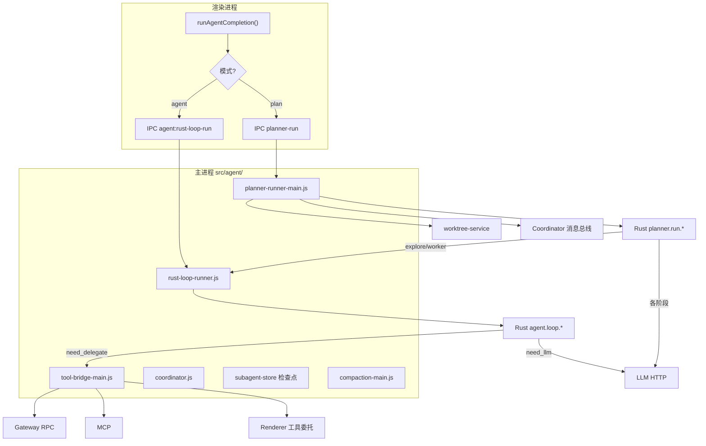

### 5.1 单 Agent 工具循环（时序）

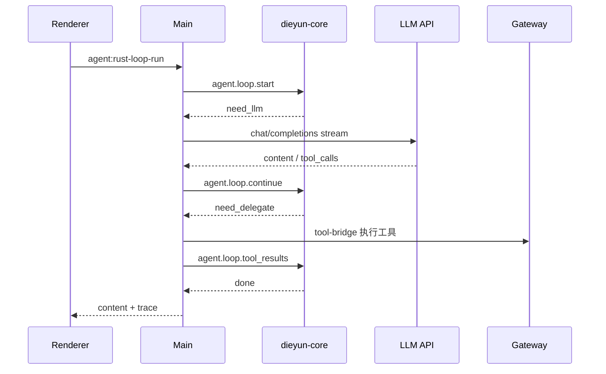

要点：

- Rust 负责循环状态机**与 LLM 调用本身**（`agent/llm.rs`：请求 + SSE 解析 + 增量事件）；Main 只提供端点与请求头（`llm-request.js` 单一来源）、工具执行与 UI 事件。上下文折叠也已在循环内完成（`docs/CONTEXT-FOLD.md`）。
- 工具全部 `need_delegate` → `tool-bridge-main.js`。
- 压缩：`compaction-main.js` 在每轮 LLM 前可压缩 messages。
- 无 silent 回退 JS loop；sidecar 不可用则报错。

### 5.2 Planner 编排

触发：`getComposerAgentMode() === 'plan'`，或可恢复检查点。

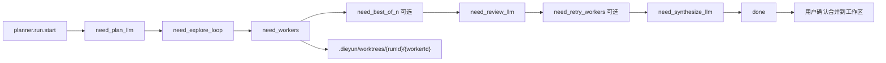

| 阶段 | agentType | 工具集 | 目的 |
|------|-----------|--------|------|
| Explore | explore | 只读 fs / 搜索 | 摸清代码库 |
| Shell | shell | 命令执行 | 构建、脚本 |
| Build | build | 读写 fs + 执行 | 改代码 |

**Worker 隔离**：Git 仓库下每个 Worker 在独立 worktree + 分支（`src/git/worktree-service.js`）。
**检查点**：`~/.dieyun/agent-checkpoints/{runId}.json`。
**后台运行**：`sessionActiveRuns` 允许切换会话后原 Agent 继续跑。

### 5.3 主进程协调器

`src/agent/coordinator.js`：run / task 队列、超时、取消、消息总线。
Planner 子 Agent 通过 coordinator 按 `toRole` 投递（`message-bus.js`）。

---

## 6. dieyun-core（Rust Sidecar）

`crates/dieyun-core`，经 `src/core-bridge.js` **stdio 行 JSON-RPC** 通信。

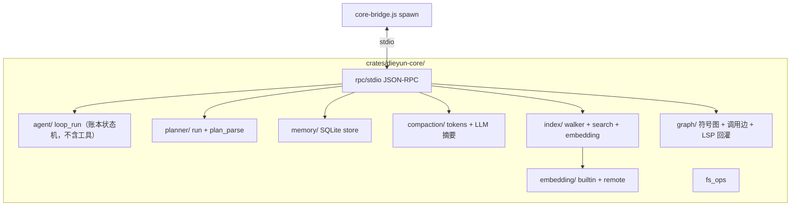

| RPC 前缀 | 职责 |
|----------|------|
| `agent.loop.*` | 单 Agent 工具循环状态机（工具在 Main，`need_delegate` 委托） |
| `agent.ping` | 能力探测 |
| `planner.run.*` | Planner 编排状态机 |
| `memory.*` | SQLite 会话/消息/长期记忆/向量 |
| `compaction.*` | token 预算、原子块折叠、摘要 |
| `codebase.*` | 工作区索引与语义搜索 |
| `graph.*` | 符号/调用图索引查询（`repo_map` / `callers` / `impact` …） |

账本口径（2026-10-28 整改）：内核**只记模型原文** —— 不解析 `agent_status`、
不做「重复前言」字符串去重、不用中文词表判定思考是否过场；通道身份由入口
`contentChannel` 盖章，交付形态由 Node 四态收口决定。
护栏数字（`maxToolCalls` / `maxRounds`）唯一来源是 `src/agent/agent-limits.js`，
经 `rust-loop-runner.applyResolvedLoopSpec` 填入 `agent.loop.start`，内核不留默认值。

打包：`npm run pack:dieyun-core` → `build/dieyun-core/dieyun-core.exe`。

---

## 7. 记忆系统

存储：`crates/dieyun-core/src/memory/` → `%APPDATA%/dieyunagent/diecloud-memory.sqlite`（WAL）。

**唯一写入路径**：Gateway `requireRustCore('memory.*')`；sidecar 未就绪则 RPC 抛 `RUST_CORE_UNAVAILABLE`。

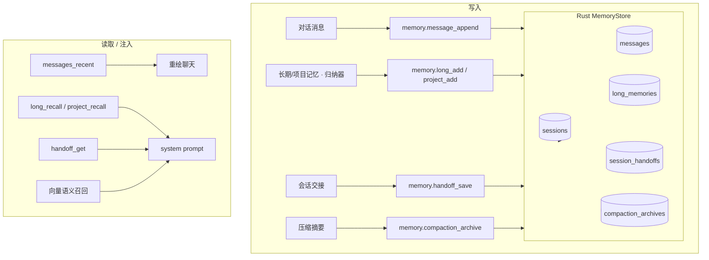

### 7.1 表结构（逻辑）

| 表 | 用途 |
|----|------|
| `sessions` | 会话元数据：title、archived、workspace_path |
| `messages` | 短期对话：user / assistant / system（含 `reasoning` 分列） |
| `long_memories` | 长期记忆：`scope=global` 用户级、`scope=project:*` 项目级；`kind` 决定能否自动注入 |
| `long_memory_vectors` | 语义索引（模型未启用则召回退到关键词） |
| `session_handoffs` | 会话交接，每会话一份 |
| `compaction_archives` | 压缩摘要归档，下轮 turn-ride 投影 |
| `request_snapshots` | 请求信封留底（旁路事实，不参与流程） |

写入方唯一性：账本 = Rust `MemoryStore`；长期/项目记忆 = Main 归纳器（`src/agent/knowledge-maintainer.js`）；
交接 = `src/agent/session-handoff.js`。详见 [MEMORY.md](./MEMORY.md)。

### 7.2 会话生命周期

- 当前会话 ID：`localStorage` `diecloud.active.session.v1`。
- 列表：`memory.sessions_list`（有消息的会话才显示）。
- 切换会话：拉 `messages_recent` 重绘 + 恢复工作空间与滚动位置。

详见 [`MEMORY.md`](./MEMORY.md)。

---

## 8. 渲染进程 UI 模块

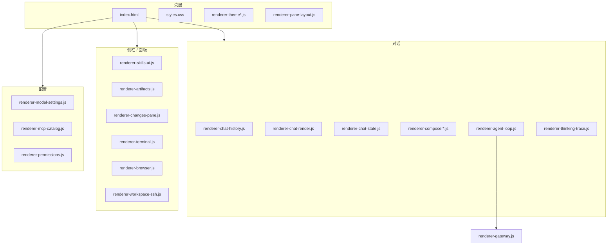

### 8.1 脚本加载顺序（节选）

1. `renderer-context-engine.js` — 上下文拼装
2. `renderer-agent-api.js` / `renderer-agent-loop.js` — Agent IPC 入口
3. `renderer-chat-render.js` / `renderer-chat-history.js` — 聊天渲染与会话
4. `renderer.js` — UI 总线

---

## 9. 技能、MCP 与插件

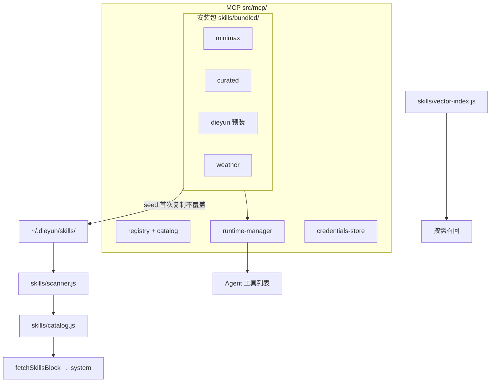

- **Bundled**：随安装包（`extraResources`）。
- **Seed**：`seed-to-dieyun.js` 复制到用户目录，已存在不覆盖。
- **启用状态**：`localStorage` `diecloud.skills.enabled.v1` 等。
- **技能本质**：主要是 system prompt 知识；部分解锁工具（如天气）。
- **预装 MCP**：`src/mcp/registry.js`。目前只预装 `mcp-postgres`（`bundledServer`，npm 包 + 平台二进制随安装包分发，`ELECTRON_RUN_AS_NODE` 启动，密钥走环境变量）。叠云 Open API 四件套（`mcp-daizhang` / `mcp-tools` / `mcp-index` / `mcp-pixel`）与 6 个第三方 npx 模板自 2026-11 起**不再预装**，改为用户按需接入（设置页「新增远端」或 Agent 工具 `mcp_manage`）；原先支撑四件套的 `src/mcp/servers/dieyun-open-api/` 与 `src/mcp/open-api-deploy-env.js` 已随之下线（预装只剩 manifest 产物一种形态）。
- **插件通道已下线**：曾有的 `src/plugins/`（宿主 + 工具注入 + 生命周期钩子）与内置目录、`plugins.*` RPC、设置页已整体删除。第三方工具只有 MCP 一条路；`onAgentTurnEnd` / `onPlanRan` 两个事件钩子在真实的钩子作者出现之前不保留抽象——需要时按当时的实际需求重做，而不是先揣测一个进程外钩子协议。


---

## 10. SSH 与远程工作空间

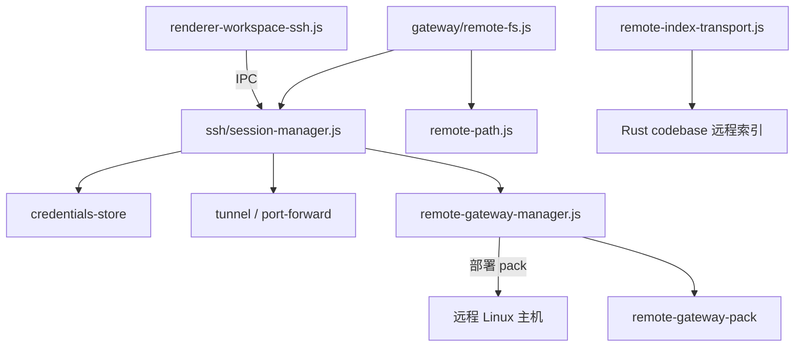

远程路径约束在 `ssh/remote-path.js`；工作空间 URI 形如 `ssh://user@host/path`。

### 远程 exec 与后台进程（句柄 / 日志 / 结束判定）

`src/exec-settlement.js`（`attachExecSettlement`）是「一条命令什么时候算跑完」的**唯一判定**，
本机 `runShell`（Node spawn）与远程 `session-manager.exec` 共用；两端各自只做超时兜底：

| 事件 | 含义 | 处理 |
|------|------|------|
| `close` | 输出管道全关了（sshd 关 session 管道 / Node 子进程 stdio 关闭） | 正常收尾，用 close 的 exit code |
| `exit`（exit-status） | 命令主体已退出，但输出管道仍被后台进程继承（`cmd &` / nohup / setsid） | 静默 400ms 后收尾（每来一段输出重置）；SSH 侧此时主动 close channel 释放资源 |
| 都不来 | 命令链还在前台跑 | 由各自的 timeout 兜底 → `SSH_EXEC_TIMEOUT` / `SHELL_TIMEOUT` |

少了这一层，后台命令就会「命令已生效却报超时」：命令早就结束了，却要等到 timeout 才把「已启动」
报成失败（原始排查记录已随 `issue/` 归档清理，结论已并入本节）。

两条配套契约（本机 `runShell` / `spawnDetachedProcess` 共用）：

- **spawn 失败只算一次失败**：失败由 `child.on('error')` settle 外层 Promise，
  `attachExecSettlement` 因同一个 error 再 reject 时由调用方接住 —— 否则会冒成主进程
  `Unhandled rejection: Error: spawn ... ENOENT`，把真错掩盖掉。
- **cwd 由 `resolveSpawnCwd` 唯一解析并校验存在**：给一个不存在的 cwd，libuv 只会回
  `spawn C:\WINDOWS\system32\cmd.exe ENOENT`（报的是 ComSpec 找不到，看不出真因）。
  现在统一回 `CWD_NOT_FOUND` + 具体路径（`retryable=false`），避免模型在同一路径上盲试。

远程 `detached` 与本地同形（`gateway/remote-processes.js`）：`setsid` 让命令自成进程组 →
`pid` 即命令本身（可 `kill -TERM -pid` 结束整棵树），stdout/stderr 落 `/tmp/dieyun-host-proc/`，
并登记 `sshproc-N` 句柄供 `host_proc`（list / output / kill）使用 —— 与本地 `hostproc-N` 一套语义。

---

## 11. 浏览器自动化

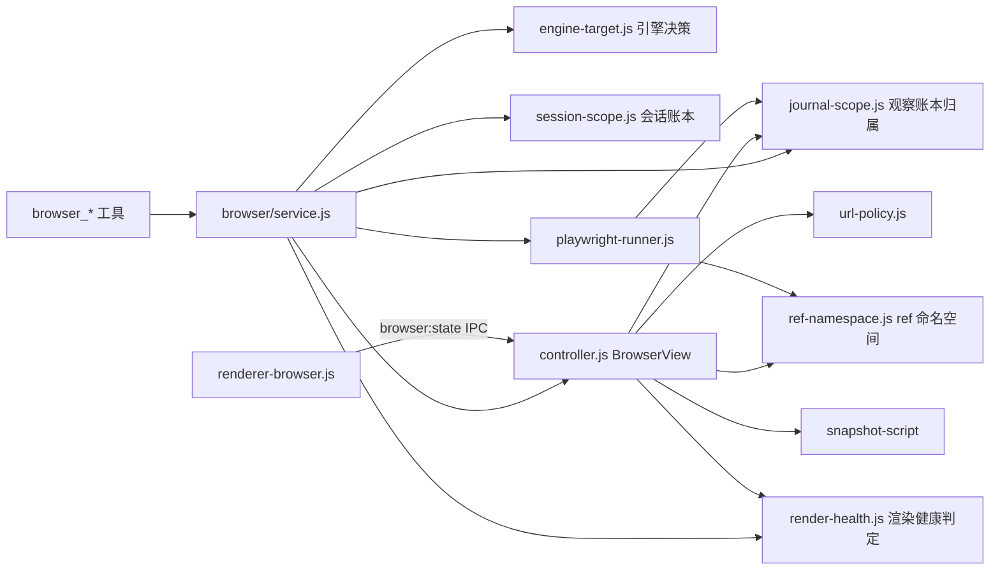

内嵌 `BrowserView`，仅允许 http/https；快照与点击坐标脚本在 `browser/snapshot-script.js`。

### 引擎选择、ref 身份与观察归属（三个单一来源）

| 关注点 | 单一来源 | 语义 |
|--------|----------|------|
| 引擎选择 | `browser/engine-target.js` | 显式 `engine` 参数优先；`auto` 跟随会话导航归属（存在 session-scope 的 `meta.engine`）；后台会话强制 Playwright 并在结果里标 `downgraded`/`downgradeReason` |
| 实例身份 | `browser/engine-target.js`（`instanceIdFor`） | 每个 `browser_*` 结果带 `target.instanceId` = `<engine>#<生效会话 id>`（会话身份先经 `session-scope.resolveEffectiveSessionId` 归一），换引擎（含运行期改道）或换会话即换实例；仅未绑定会话时为 `#default` |
| ref 命名空间 | `browser/ref-namespace.js` | ref 形如 `ref-<seq>@<snapshotId>`，自带 origin 身份；`enrichRefFailure` 是 ref 失效错误体的唯一组装点 |
| 观察账本归属 | `browser/journal-scope.js` | network / console / timeline 按**会话**分桶，`engine` 只是条目属性 |

ref 的 origin 身份由 Node 侧在每次 snapshot 前铸造（全进程单调、base36），同一次 snapshot 的所有 frame 共用一个 id；
`browser/service.js` 把它写进 session-scope（`meta.snapshot`，含 `epoch`）并回灌结果。

**失效判定发生在将要解析它的那个 DOM 上**，两侧各查自己 DOM 最后盖章的 snapshot：

- BrowserView：页面内 `window.__dieyunRefSnapshotId`（子 frame 里跑 snapshot 时同步镜像到同源 top）
- Playwright：`sessions.get(key).snapshotId`

旧 ref 一律得到 `REF_EXPIRED` / `REF_NO_SNAPSHOT` / `REF_MALFORMED`（各自触发条件见「ref 失效诊断」一节的 `refLifecycleNote`），**不会**静默命中页面里残留的同名属性；
这类失败也不参与跨引擎兜底重试（换引擎只会命中另一份 DOM 的旧状态）。

### ref 失效诊断与空闲会话回收

`ref-namespace.enrichRefFailure` 是 ref 失效错误体的唯一组装点：引擎侧只判定「这个 ref 不属于当前 snapshot」，
`browser/service.js` 把会话账本里的事实喂进去，两套引擎共用同一份诊断。字段约定：

| 字段 | 含义 |
|------|------|
| 顶层 `engine` / `instanceId` / `url` / `refEpoch` / `navigatedSinceSnapshot` | 渲染层与调用方直接可读的落点事实 |
| `diagnostics` | 结构化事实（另含 `snapshotId` / `currentSnapshotId`）；`tool-harness.classifyFailure` 归一化失败信封时**必须原样保留**，否则模型只知道「失败了」 |
| `suggestedFix` | 唯一的「下一步怎么做」文案（重新 `browser_snapshot` 或用 CSS selector） |
| `retryable: false` | ref 失效不是暂时故障，原样重试只会再打一次同一个旧 ref |

`instanceId` / `engine` / 会话账本键同源：`session-scope.resolveEffectiveSessionId`（显式 `sessionId` → 前台 BrowserView 会话）
是唯一口径，因此 auto 调用（不带 `sessionId`）与显式调用对同一实例给同一个名字；只有「确实还没绑定任何会话」才落到 `#default` 缺省键。

`navigatedSinceSnapshot` 由 session-scope 判定，两个证据任一成立即为 true：

1. **事件序号**：snapshot 与导航共用一条单调 `seq`，导航比 snapshot 晚即已跳转（不看时间戳 —— 同一毫秒内的 snapshot + 导航不能判成「没跳转过」）；
2. **url 变化**：`snapshot.url` ≠ 当前 url。页面自己跳转（表单提交 / JS 重定向 / 点链接）不经过 navigate 工具、账本里没有事件，
   只有 url 能认出来；引擎在失败体里自报当场 url（in-page `location.href` / Playwright `page.url()`），`service.js` 因此能一眼区分
   「跳转导致失效」与「被新 snapshot 取代导致失效」。url 未知（空）时不用它臆断。

旧 ref 会报哪个 code、为什么，文案唯一来源是 `ref-namespace.refLifecycleNote`（两套引擎的 snapshot note 都引用它）：
页面跳转后报 `REF_NO_SNAPSHOT`（新文档里没有 snapshot 印章），同一文档内再次 snapshot 后报 `REF_EXPIRED`（origin 已不是当前 snapshot）。

Playwright 空闲会话回收（`playwright-runner.js`）：会话新增 `lastUsedAt`，每次 `ensurePage` 刷新；
定时 sweep 只关「非活动会话 + 超过 `idleSessionMs` 没被调用」的那些（默认 10 分钟，`DIEYUN_PW_IDLE_MS` 覆盖，`0` 关闭），
下次调用按需重建。`status()` 返回 `idleSessionMs` 与逐会话 `lastUsedAt`，可确认没有长期挂着的无头实例。

### 观察账本按会话归位

`browser_network` / `browser_console` / `browser_timeline` 读的是 `journal-scope.js` 里**该会话**的桶，
不是「当前引擎」的桶。归属键只有一条规则：显式 `sessionId` → 前台 BrowserView 会话 → `__view__`。

- 写入：BrowserView 用 view 承载的会话（`activePartitionSessionId`）；Playwright 用 page 上的 `__dieyunSessionKey`；
  页面侧 timeline binding 挂在会话的 context 上。
- `engine` 从「账本归属」降级为「条目属性」：`engine=auto` 读本会话全部条目，显式 `engine=X` 只是过滤，不再换桶读。
- `browser.reset_logs` 必须带 `sessionId`（Agent 每轮开始调用）：只清本会话的 console/network，
  并记下清空时间，查询时在 `note` 里明说，避免把「已清空」误读成「请求没发出去」。
- 会话关闭 / 浏览器整体关闭时丢弃对应桶。

### 渲染健康：暗 ≠ 空（`browser/render-health.js`）

像素全黑只说明画面**暗**，不说明页面**空**：纯黑主题站点（`#000` + 白字）截图就是整幅全黑。
把「暗」当「空」会触发引擎改道，而 ref / Cookie / 登录态都贴在原实例上 —— 代价是「换了一台机器」。

判定只有两类事实 + 一条结论，全部收在 `browser/render-health.js`：

| 事实 | 来源 | 说明 |
|------|------|------|
| `darkPixels` | 截图像素统计（`controller.analyzeImage`）或 BGRA 位图 | 只表示「整幅全黑」；`sampleCount:0`（没采到样）不算全黑 |
| `content` / `contentKnown` | 页面侧脚本 `buildContentSignalsScript()` | 文本长度 / 可见交互元素数 / canvas·img·svg 数；取不到即「未知」 |
| `likelyBlank` | 两者合成（`classifyRenderHealth`） | **全黑 且 页面确认无可见内容**；`blankReason` 记录是哪种情况 |

约束：

- `likelyBlank` 才允许触发引擎改道（`service.fallbackToPlaywrightAfterBlank`）与重绘恢复（`controller.probeAndRecoverBlankPaint`）；
  深色主题页面**不判定、不改道、不重挂 view**。
- 内容信号取不到（脚本失败）时不得断言「空」（`blank_reason: dark_pixels_content_unknown`）——误改道代价远大于漏报。
- 同一个脚本既是可直接求值的表达式（`executeJavaScript` / `page.evaluate`），也是 `buildEvaluateScript` 的脚本体，两引擎同源。
- `visual_diff` 自己也探内容事实：深色主题截图是合法基准；位图尺寸/长度异常单独报 `CAPTURE_INVALID`，不再混进 `BLANK_CAPTURE`。

---

## 12. 定时任务（Plans）

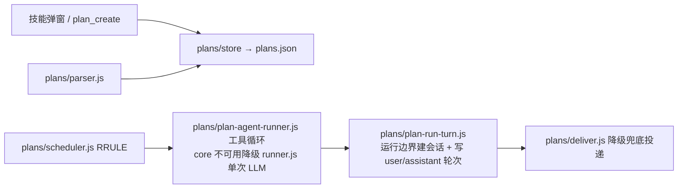

| 对比 | 对话 Agent | 定时任务 Plans |
|------|------------|----------------|
| 入口 | 主聊天 | 技能弹窗 / 工具 |
| 执行 | 多轮工具循环 | 工具循环（Main 调度）；core 不可用降级单次 LLM |
| 存储 | SQLite messages | `userData/plans.json` + 计划专用会话 |
| 投递 | 当场显示 | **运行时**即建会话并写 user 轮次，终态前写 assistant 轮次（`plan-run-turn.js`） |

---

## 14. 自动更新与打包

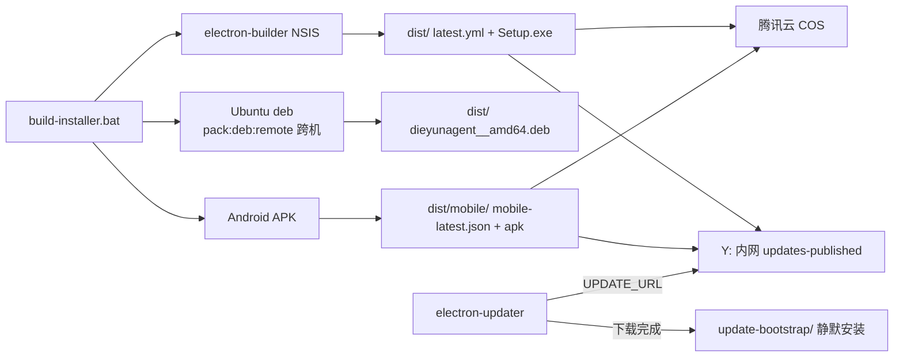

| 步骤 | 命令 / 路径 |
|------|-------------|
| 一键打包发布 | `build-installer.bat`（输入版本号，构建 PC + Ubuntu deb + 手机，发布 Y: + COS） |
| 仅 PC 打包 | `npm run build:nsis` |
| 仅 Ubuntu deb | `npm run pack:deb:remote`（跨机打到 Linux 构建机，产物拉回 `dist/`） |
| 仅内网发布 | `scripts\publish-updates-to-y.bat` |
| 仅 COS 上传 | `node scripts\upload-updates-cos.mjs` |
| 可选资源上传 | `npm run upload:optional-cos` |
| 默认更新 URL | `http://192.168.31.62:3099/`（`main-entry.js`） |

---

## 15. 代码库索引

```mermaid
flowchart TB
  UI[索引触发 / Agent 搜索] --> GWcode[Gateway codebase.* / graph.*]
  GWcode --> RustIdx[Rust index + treesitter]
  GWcode --> RustGraph[Rust graph build + query]
  RustIdx --> Embed[embedding remote endpoint (opt-in)]
  RustIdx --> SQLiteIdx[(索引 SQLite)]
  RustGraph --> SQLiteGraph[(图 SQLite)]
  LSP[Gateway LSP enrich] -->|standing job| SQLiteGraph
```

### 15.1 Codebase 文本索引

- `codebase.*` 仅 Rust 实现（含远程仓库的采集与索引）。
- 切块优先 **Tree-sitter**（JS/TS/Python/Go/Rust 按函数/类边界）；失败回退行窗（`CHUNK_LINES` / overlap）。AST 之外的**未覆盖行**（函数上方的注释、顶层语句）单独成 chunk：文件的每一行都进索引。
- 单仓库文件上限 **16000**；`codebase.search` 结果上限 **48**。
- 向量检索：**只有一条路径** —— 常驻内存池（`index/vector_pool.rs`）全量精确余弦，recall 100%。池装不上（IO 异常 / 维度不符）时该通道缺席、只出词法结果，**不做抽样近似**（抽样会让同一查询在池冷/暖时给出不同答案）。
  - 实测成本（114k chunk）：建池 2.2s（一次），单次扫描 768 维约 350ms、内存 340MB。更大规模要提速就上真正的 ANN 索引，而不是模量抽样。
- 检索融合：向量（余弦）/ 子串（`LIKE`，见下）/ 符号定义点三路**按名次**做 RRF（`k=60`），不拼分数 —— 余弦与子串命中量纲不同，加权求和必须配不可验证的魔数。`score` 字段是「相对本次头名」的归一化值（头名恒 1.0），只用于展示排序信心。同分候选按 chunk id 兜底排序，保证同一查询两次调用顺序一致（融合结果来自 HashMap 迭代）。
- **强证据不进投票**：符号定义点、以及「查询词元全部命中」的词法命中，是可验证的字面事实，直接排在融合结果之前（加成取 `n/(k+1)` = 所有通道都满分投给同一候选的上界，故非强证据永远追不上，强证据之间仍按融合分排序）。没有这层时，查询本身就是源码原句的场景里正确第 1 名会被向量票挤到 2–4（实测 hit@1 100% → 83% / 67%）。改写问法下没有任何块全命中，行为与纯 RRF 完全一致 —— 向量只在这种「字面没有强证据」的场合决定名次。判据与复测见 `docs/INDEX-VALUE-REVIEW.md` §7.6。
- **本地 trigram FTS 通道已删除**（`SCHEMA_VERSION = 4`，迁移只做 `DROP TRIGGER` ×3 + `DROP TABLE chunks_fts`）：它占索引库 40%（426 MB / 1056 MB）却与 `grep` 工具功能重叠、且新鲜度落后一轮增量。评测与判据见 `docs/INDEX-VALUE-REVIEW.md`（R2）。
- 词法召回取而代之的是**子串通道**（唯一词法来源）：查询按空白与标点切词（去掉 1 字词，上限 12 个），每个词对 `content` 与 `rel_path` 各跑一次 `LIKE '%term%' ESCAPE '\'`，按「命中词数」降序、chunk id 兜底排序；命中行号由首个命中位置回填。中文 2 字、3 字、标识符子串（`parse_config`）走同一条路 —— **没有分词下限、也没有扫描窗口**。代价是单次全表扫（本仓 10,846 chunk ≈ 20 ms，74k chunk 外推 ≈ 140 ms）。
- 向量通道是**建库时显式 opt-in**：`codebase.index.start` / `codebase.index` 的 `vectors` 参数（缺省 `false`），出口是面板「建向量」按钮与 CLI `--vectors`；查询侧不变（`vector_count > 0` 且签名匹配就自动用）。`vectors` 描述的是**本次请求**：不带它不会删掉已有向量（清空只发生在 `force` 全量重建与 embedding 签名变更），元数据（`vector_count` / `embedding_model` / `embedding_dims`）始终描述库里真实存在的向量；要向量但端点没配时返回 `EMBEDDING_NOT_CONFIGURED` 而不是静默只建片段。`codebase-incremental-scheduler` 对「已建过向量」的工作区增量时带 `vectors: true`（否则增量删掉的旧 chunk 会把向量一起带走，覆盖率单向下滑）。生命周期细则见 `docs/VECTOR-SEARCH.md` §1.1。

### 15.2 代码图谱

- 构建：`graph.index` / `graph.index.start`，AST 抽取符号、import（与 codebase 同语言范围）。模块名只认 AST 的 `source` 字段（`export const X = "lit"` 不是依赖）。
- **建库范围分两档**（`GraphScope`，RPC 参数 `calls: boolean`，缺省 `false`）：`Structural` 只建 `graph_symbols` / `graph_imports` / `graph_file_mtime`（`repo_map`、`symbol_search`、`module_deps` 的底座，常建）；`WithCalls` 额外抽 `graph_calls`（实测 391k 行 / 65 MB，而 7 天里只有 1 次 `graph` 调用）。`graph.callers` / `callees` / `lsp_resolve` 在「已建库但 `call_count === 0`」时会自动补建一次（`calls: true`，增量模式下对未变文件也会重解析，否则永远抽不出边）并返回 `GRAPH_INDEXING_IN_PROGRESS` 提示稍后再试。
- 结构索引保留的核心理由是 **`repo_map`**：≤4500 字符换来「全局骨架 + 枢纽文件 + 关键符号 + 模块边 + 循环依赖」，`grep` / `read_file` 结构上无法回答「这个仓库长什么样、哪里是枢纽」。它**不再要求用户先点名文件**（注入门是 `allowCodebase`，与 `injectCode` 解耦；详见 `docs/INDEX-VALUE-REVIEW.md` R8）。
- 解析口径：调用边只按**证据**解析 —— 同文件符号 → import 目标文件的符号 → （建库收尾）**全库唯一**同名符号；找不到证据就保持未解析（`callee_symbol_id IS NULL`），**不按字典序猜同名**（那会凭空造边，且结果取决于文件名排序）。增量重建时改动文件的入边只**撤销解析**、不删行（调用方文件没变、不会重扫）。
- 查询：`graph.symbols`、`graph.callers` / `callees`、`graph.repo_map`（枢纽文件/符号 + markdown 摘要）。`callers` 按符号 id 认已解析边、按裸名只认未解析边；**符号已不存在**时（改名/删除）返回 `symbol: null` + 该名字的悬空调用点，正是「谁还在调这个已经没了的东西」。调用归属按作用域（`start_line <= line <= end_line`），函数体之后的文件级调用不算上一个函数的。
- Agent 准备上下文时注入「仓库结构图」；后台可 kick `graph.lsp_enrich`（冷却约 10 分钟）用 LSP 补全 callers。
- 符号级语义检索已整体移除（`graph.embed_symbols` / `graph.symbol_semantic_search` / `graph_symbol_vectors`）：自然语言找代码走 `codebase.search`（chunk 级向量），按名/按关系找符号走 `graph.symbol_search` / `callers` / `callees`。

---

## 16. 附录：目录速查与数据路径

### 16.1 源码目录

| 路径 | 内容 |
|------|------|
| `src/main-entry.js` | 主进程中枢 |
| `src/gateway/` | 本地 RPC 服务 |
| `src/agent/` | Agent / Planner / 工具桥 / 压缩 |
| `src/renderer/` | 全部 UI 模块 |
| `crates/dieyun-core/` | Rust sidecar |
| `skills/bundled/` | 预装技能 |
| `src/ssh/` | 远程 SSH 工作空间 |
| `src/plans/` | 定时任务 |
| `src/browser/` | 内嵌浏览器自动化 |
| `src/update-bootstrap/` | 更新安装引导 |
| `src/mcp/` | MCP 运行时 |
| `src/lsp/` | 语言服务诊断 |
| `src/git/worktree-service.js` | Planner Worker 隔离 |

### 16.2 运行时数据路径

| 路径 | 内容 |
|------|------|
| `%APPDATA%/dieyunagent/` | userData：Gateway DB、权限、workspace、plans、更新 token |
| `~/.dieyun/` | skills、memory 笔记、默认 workspace、dieyun.md、checkpoints |
| `~/.dieyun/workspace/` | 未选工作空间时的默认可写目录 |
| `dist/` | 打包输出 |
| `Y:\client-electron\updates-published` | 内网更新静态文件 |

---

*文档版本：与仓库 `package.json` 同步维护 · 生成目的：A4 打印成册*
