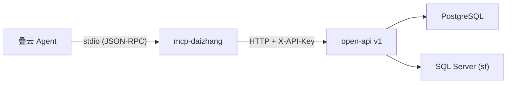

# mcp-daizhang 开发与改造文档

- 服务名：`mcp-daizhang`（显示名「叠云代账」，启动命令 `内置 daizhang`）
- 对接后端：叠云代账 open-api v1 `http://192.168.31.62:3011/api/open-api/v1`
- 文档日期：2026-10-20
- 适用对象：需要给 MCP 侧加工具 / 修 bug 的开发人员

> 本文只讲**这个代账 MCP 服务**怎么开发改造，不是 MCP 协议通用教程。

---

## 1. 现状与源码位置

| 项 | 说明 |
|---|---|
| 部署形态 | 叠云客户端内置服务，由客户端 spawn 子进程，stdio 传输 |
| 源码位置 | **不在** `dieyundaizhang` 仓库（`glob **/*mcp*` 与关键字搜索均无命中） |
| 可见产物 | 仅运行时行为：3 个工具、返回信封、`pageSize` 截断 |
| 鉴权 | 复用 open-api 的 `X-API-Key`（当前 Key 前缀 `sk_02ff2b9a`） |

**改造前提**：需先拿到该服务的源码或安装目录（客户端安装包内 / 独立仓库）。本文给出改造规格与参考实现，拿到源码后按第 5 节改、第 7 节验。

---

## 2. 架构



职责边界：

- **MCP 层**：参数校验、工具描述（决定模型能否选对工具）、错误翻译、结果裁剪。**不承载业务口径**。
- **open-api 层**：口径、鉴权 scope、分页。税负口径唯一来源是 `packages/backend/src/invoice/invoice.service.ts`。

> 原则：MCP 侧不要再算任何税额，全部透传 open-api 结果。否则又会出现「Agent 自算与界面不一致」的老问题。

---

## 3. 现有工具契约（实测）

| 工具 | 入参 | 后端 | 备注 |
|---|---|---|---|
| `ping` | 无 | `GET /ping` | 返回 `{ok, service:"daizhang", path, ts, data}` |
| `list_customers` | `kw` / `status` / `page` / `pageSize` | `GET /customers` | pageSize schema 上限 200 |
| `list_invoices` | `tenantId`(必填) / `type` / `period` / `periodFrom` / `periodTo` / `dateFrom` / `dateTo` / `page` / `pageSize` | `GET /invoices` | **无勾选状态等过滤参数** |

返回统一信封：`{ ok, service: "daizhang", path, ts, data }`，`data` 为 open-api 的 `data` 原样。

---

## 4. 已知缺陷

### 4.1 `pageSize` 被硬截断为 50

**复现**：`list_invoices({ tenantId: "9cfede55-...", pageSize: 51 })`
**结果**：`data.returned = 50`、`data.truncated = true`，而 schema 声明 `pageSize.maximum = 200`。

**根因（推断）**：MCP 适配层里写死了 `Math.min(pageSize ?? 50, 50)`，schema 与实现不一致。
open-api 侧实测支持到 500（`/invoices?pageSize=500` 正常）。

**影响**：Agent 以为拉全了，实际少 1/4；对账时 `total` 与实际不符，无法发现缺页。

**修法**：见 5.3。

### 4.2 无税负工具

MCP 侧没有 `tax_burden`，Agent 查税负只能绕过 MCP 直连 open-api，丢掉工具发现的便利性。见 5.1 / 5.2。

---

## 5. 改造规格

### 5.1 新增 `tax_burden`

映射到 `GET /tax/burden`。

| 参数 | 类型 | 必填 | 默认 | 说明 |
|---|---|---|---|---|
| tenantId | string | 是 | — | 来自 `list_customers` 的 id |
| periodFrom | string `YYYY-MM` | 是 | — | 起始税款所属期 |
| periodTo | string `YYYY-MM` | 是 | — | 结束税款所属期 |
| granularity | `month`/`year`/`total` | 否 | `total` | MCP 默认给 `total`，最省 token |
| caliber | `client` | 否 | `client` | 目前仅 `client` 可用 |
| includeUnsettled | boolean | 否 | `false` | 是否含未完结当期 |

**描述文案建议**（直接影响模型选工具，务必写清"税负"二字）：

> 查询客户增值税税负汇总（销售额、销项税额、可抵扣进项税额、应纳增值税、税负率），含固定资产累计税负指标。periodFrom/periodTo 格式 YYYY-MM。查"税负率/应交税费/增值税负担"时用这个工具，不要用 list_invoices 自己算。

**返回**：原样透传 `data`，不做二次加工。

### 5.2 新增 `tax_declaration`

映射到 `GET /tax/declaration`，入参 `tenantId` + `period`（`YYYY-MM`，必填）。
`declared=false` 时金额为 `null`，属正常返回，**不要当成错误抛**。

### 5.3 修正 `pageSize`

```ts
const PAGE_SIZE_MAX = 500;           // 与 open-api 对齐
const pageSize = Math.min(PAGE_SIZE_MAX, Math.max(1, args.pageSize ?? 50));
```

同步把 schema 的 `maximum` 从 200 改成 500，并**如实透传** open-api 返回的 `total` / `returned` / `truncated`：

- `total` = 符合过滤条件的总行数
- `returned` = 本页实际行数
- `truncated` = `total > returned`（是否需要翻页）

不要自己再包一层截断，也不要改写 `total`。

---

## 6. 参考实现（TypeScript）

若源码是 Go/Python，语义等价，SDK 分别为 `modelcontextprotocol/go-sdk`、`mcp`(Python)。

```ts
import { McpServer } from '@modelcontextprotocol/sdk/server/mcp.js';
import { StdioServerTransport } from '@modelcontextprotocol/sdk/server/stdio.js';
import { z } from 'zod';

const API_BASE = process.env.DAIZHANG_API_BASE ?? 'http://192.168.31.62:3011/api/open-api/v1';
const API_KEY = process.env.DAIZHANG_API_KEY ?? '';
const TIMEOUT_MS = Number(process.env.DAIZHANG_TIMEOUT_MS ?? 15000);
const PAGE_SIZE_MAX = 500;

async function callApi(path: string, params: Record<string, unknown> = {}) {
  const url = new URL(API_BASE + path);
  for (const [k, v] of Object.entries(params)) {
    if (v !== undefined && v !== null && v !== '') url.searchParams.set(k, String(v));
  }
  const ctrl = new AbortController();
  const timer = setTimeout(() => ctrl.abort(), TIMEOUT_MS);
  try {
    const res = await fetch(url, {
      headers: { 'X-API-Key': API_KEY, Accept: 'application/json' },
      signal: ctrl.signal,
    });
    const body = await res.json().catch(() => null);
    if (!res.ok || !body?.ok) {
      // 401 缺 Key、403 缺 scope、400 参数错 —— 原样抛出，别吞
      throw new Error(`open-api ${res.status}: ${body?.message ?? res.statusText}`);
    }
    return body.data;
  } finally {
    clearTimeout(timer);
  }
}

const server = new McpServer({ name: 'daizhang', version: '1.1.0' });

server.registerTool(
  'tax_burden',
  {
    title: '税负汇总',
    description:
      '查询客户增值税税负汇总（销售额、销项税、进项税、应纳增值税、税负率），含固定资产累计税负指标。查税负率/应交税费时用本工具，不要用 list_invoices 自行核算。',
    inputSchema: {
      tenantId: z.string().min(1).describe('客户 ID，来自 list_customers 的 id'),
      periodFrom: z.string().regex(/^\d{4}-\d{2}$/).describe('起始税款所属期 YYYY-MM'),
      periodTo: z.string().regex(/^\d{4}-\d{2}$/).describe('结束税款所属期 YYYY-MM'),
      granularity: z.enum(['month', 'year', 'total']).optional().default('total'),
      caliber: z.enum(['client']).optional().default('client'),
      includeUnsettled: z.boolean().optional().default(false),
    },
  },
  async (args) => ({
    content: [{ type: 'text', text: JSON.stringify(await callApi('/tax/burden', args), null, 2) }],
  }),
);

server.registerTool(
  'tax_declaration',
  {
    title: '申报口径明细',
    description:
      '查询某客户某税款所属期的申报口径数据（销项、进项、进项转出、期初/期末留抵、应纳、已缴）。未申报时金额为 null 属正常返回。',
    inputSchema: {
      tenantId: z.string().min(1).describe('客户 ID'),
      period: z.string().regex(/^\d{4}-\d{2}$/).describe('税款所属期 YYYY-MM'),
    },
  },
  async (args) => ({
    content: [{ type: 'text', text: JSON.stringify(await callApi('/tax/declaration', args), null, 2) }],
  }),
);

await server.connect(new StdioServerTransport());
```

> 老版本 SDK 用 `server.tool(name, description, schema, handler)`，语义相同。

---

## 7. 配置

| 环境变量 | 必填 | 默认 | 说明 |
|---|---|---|---|
| `DAIZHANG_API_BASE` | 否 | `http://192.168.31.62:3011/api/open-api/v1` | 后端地址 |
| `DAIZHANG_API_KEY` | 是 | — | open-api Key，勿硬编码 |
| `DAIZHANG_TIMEOUT_MS` | 否 | 15000 | 单次请求超时 |

**scope 依赖**：`tax_burden` / `tax_declaration` 需要 Key 具备 `tax` 作用域。服务端已加（`open-api-settings.json` 的 `scopes` 含 `customers/invoices/tax`），新装客户端默认也带；**存量配置需在「设置 → 对外接口」手动勾选**，否则 403。

---

## 8. 调试与验收

### 8.1 调试

```bash
# 官方 inspector
npx @modelcontextprotocol/inspector <启动命令>

# 或直接看工具列表
echo '{"jsonrpc":"2.0","id":1,"method":"tools/list"}' | <启动命令>
```

### 8.2 验收清单

| # | 用例 | 期望 |
|---|---|---|
| 1 | `ping` | `ok: true` |
| 2 | `list_invoices({pageSize: 51})` | `returned = 51`、`truncated = true`（**不再被截到 50**） |
| 3 | `list_invoices({pageSize: 500})` | `returned ≤ 500`，`total` 与逐页累加一致 |
| 4 | `list_invoices({checkStatus: '已勾选'})` | `total` 小于未过滤时（觅柔进项 2508 → 1775） |
| 5 | `tax_burden` 觅柔 2026-01~09 `granularity=total` | `payable = 148395.87`、`burdenRate = 0.9526`、`fixedAssetDoubleDeductionAmount = 3969.02` |
| 6 | `tax_burden` 同上 `granularity=month` | 9 个月，2026-09 `burdenRate = 1.0585` |
| 7 | `tax_declaration` 觅柔 2026-09 | `declared: true`、`payable = 35226.93` |
| 8 | `tax_declaration` 未申报月份 | `declared: false`、金额 null、**不报错** |
| 9 | 缺 scope 的 Key 调 `tax_burden` | 明确提示"未授权 tax 作用域"，不是裸 403 |

基准客户：河北觅柔纺织品制造有限公司 `9cfede55-643b-4d81-be21-32986a78fe6e`。
完整口径与勘误见 `docs/open-api-tax-burden-reply.md`。

---

## 9. 发布注意

1. MCP 服务随客户端内置发布，改完需重新打包；新增工具向后兼容，老调用不受影响。
2. `pageSize` 上限从 50 提到 500 属**行为变更**：原先依赖 50 截断做"分批"的调用方会一次拿到更多数据，注意内存与 token 消耗。
3. 发版前用第 8.2 全量跑一遍，尤其第 2、3 条（这次就是 schema 与实现不一致埋的雷）。
