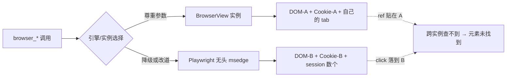

# 叠云内置浏览器（`browser_*`）缺陷报告

> **采集时间**：2026-09-22　**采集环境**：叠云 Agent（Windows 本机）+ 内置浏览器工具
> **被测站点**：`http://192.168.31.62:3003/`（PixelOfficeMonitor，Express + Socket.IO）
> **关键页面**：`/login.html`（纯黑主题 · 360px 卡片）、`/3d/`（three.js canvas）
> **采集方式**：Agent 侧实测（工具返回值原文）+ 项目源码复核（行号可查）
> **适用读者**：改内置浏览器工具的人

---

## 0. 一句话结论

**同一台机器上并存两套浏览器实例**（面板里的 BrowserView + 后台无头 Playwright/msedge），`browser_*` 调用**可能落到不同实例**；而 `ref` 只是 `browser_snapshot` 时写进**某一个** DOM 的临时属性 `data-dieyun-ref`。于是"标签贴在一台、点击落到另一台"→ 报**元素未找到**。



**责任边界（重要）**：本项目源码中 `grep -E "likelyBlank|renderHealth|darkRatio|data-dieyun-ref"` **0 命中** —— 上述判定与 ref 机制**全部来自工具层**，被测站点只是恰好长成了容易触发它的样子（深色主题 + 多跳跳转）。

---

## 1. 现场证据

### 1.1 工具返回值（实测原文）

| # | 字段 / 现象 | 实测值 | 说明 |
|---|---|---|---|
| 1 | `activeEngine` | `playwright` | 当前**活动**引擎 |
| 2 | `interactionEngine` | `browserview` | 当前**交互**引擎 —— **同一份 status 里两字段不一致**，这就是"落点漂移"的机制来源 |
| 3 | `playwright.headed` / `headless` | `false` / `true` | 后台那套是**无头**的，屏幕上不存在窗口（用户因此看不到"正在输入密码"） |
| 4 | `playwright.sessionCount` | `3` | 后台同时挂着 3 个会话 |
| 5 | `browserview.hasView` / `panelOpen` | `true` / `true` | 面板那套正常渲染（`/3d/`、`canvasCount=1`） |
| 6 | `browser_tabs` 返回的 tab | 本次 `tab-15`；此前依次见过 `tab-6`/`tab-7`、`tab-0` | **tab 列表与编号不稳定**，两套实例各有标签空间，同一会话内编号会漂 |
| 7 | `browser_snapshot` 的 note（工具自述） | "**ref 在本次 snapshot 内有效；页面跳转或再次 snapshot 后需重新获取**" | 工具自己已声明 ref 是一次性的 |
| 8 | 点击报错原文 | `{"ok":false,"locator":{"_selector":"[data-dieyun-ref=\"ref-1\"] >> nth=0"}}` | ref 不是元素 id，只是属性选择器，跨文档必 0 匹配 |
| 9 | `browser_evaluate` 的 `refsInDom` | `8`（snapshot 后）；此前实测出现过 `8 → 0` | 同一实例内标记存在 → **一旦落到别的实例即归零** |
| 10 | renderHealth 判定方式 | `darkRatio` / `blankBlack` / `avgBrightness` / `sampleCount:4099` | **基于像素截图统计**，不基于 DOM 内容量 |
| 11 | 登录页判定结果 | `likelyBlank:true`、`darkRatio:0.993`，并警告"建议改用 playwright" | 纯黑主题被当成"没渲染出来" |
| 12 | 3D 页判定结果（对照） | `likelyBlank:false`、`darkRatio:0`、`avgBrightness:201.4` | 该页 body 也是深色（`rgb(11,14,19)`），但画面有内容 → 不判 blank。说明判据是**像素亮度**而非主题色 |
| 13 | `forcePlaywrightUrl` | `""`（字段存在） | 说明**存在"按 URL 强制降级到 playwright"的开关**，需查它与 `likelyBlank` 是否联动 |
| 14 | `browser_network` 缓冲 | 登录请求常查不到；`stats` 只剩导航后请求（`total:15`） | **主框架导航会重置网络缓冲**，关键请求被洗掉 |

### 1.2 项目源码复核（证明页面侧无缺陷）

| 项 | 事实 | 位置 |
|---|---|---|
| 登录页配色 | **5 处** `background: #000`：body(14) / `.card`(22) / `input`(52) / `button`(67) / `button:hover`(74) | `server/public/login.html` |
| 登录逻辑 | `submit` → `preventDefault()` → `fetch('POST /api/auth/login')` → `res.ok` 才 `location.replace(nextUrl)`；服务端**只回 JSON，无 302** | `server/public/login.html`（脚本段） |
| 登录结果 | `POST /api/auth/login` → **200，耗时约 5ms**，随后 `GET /3d/` 200，canvas 正常 | 实测 |
| 前端错误 | 页面 console **0 error**、0 未捕获异常 | 实测 |
| 工具层判定 | `likelyBlank` / `renderHealth` / `darkRatio` / `data-dieyun-ref` 在项目源码中 **0 命中** | 全库 grep |

---

## 2. 缺陷清单（按优先级）

### 🔴 P0-1　显式指定的引擎不被尊重，且静默改道

- **现象**：传 `engine=browserview`，返回体里出现 `"engine":"playwright","channel":"msedge"`；同一份 status 里 `activeEngine` 与 `interactionEngine` 可同时为不同值。
- **证据**：§1.1 第 1、2 行。
- **期望**：① 严格尊重参数；或 ② 降级时返回显式信息 `engineFallback:{requested,actual,reason}`；**最低要求：返回值里必须带实际引擎 `actualEngine`**。
- **影响**：调用方无法判断自己在操作哪个浏览器实例 —— 这是"用户看不到输入密码""刚登录又被要求登录"的直接来源。
- **修法**：在引擎解析处比对"请求值 vs 实际值"，不一致时**必须回传 + 打日志**；降级只允许在调用方显式开启时发生。
- **定位锚点**：`activeEngine`、`interactionEngine`、`forcePlaywrightUrl`

### 🔴 P0-2　双实例并存、状态不共享、调用落点漂移

- **现象**：BrowserView 与 Playwright 各有 DOM / Cookie / tab 空间；`browser_tabs` 两次调用返回两套不同实例；同一 URL 两次 `evaluate`，一次 8 个 ref、一次 0 个。
- **期望**：每次调用都返回并复用 **`instanceId` + `tabId`**；或统一收敛到单一实例。
- **影响**：① Cookie 不共享 → 同一站点要**登录两次**；② ref 跨实例失效 → "元素未找到"；③ 面板里看到的与被操作的可能不是同一页面（用户视角 = "你好像在瞎操作"）。
- **修法**：给引擎/实例分配稳定 id 并在每个 `browser_*` 返回体中回传；`snapshot → click` 之间锁定同一实例（至少同一"操作序列"内复用）。
- **定位锚点**：`activeSessionId`、`sessionCount`、`headed`、`headless`

### 🟠 P1-3　ref 一次性、失效后不重解析，只报"元素未找到"

- **现象**：locator 形如 `[data-dieyun-ref="ref-N"] >> nth=0`；跨导航/跨实例立刻 0 匹配。note 里写着"需重新获取"，但**工具不会自己重新获取**。
- **期望（任一即可）**：
  - ① ref 存为结构元组 `{role,name,tag,nth,framePath}`，点击时**惰性重查**（Playwright locator 即惰性模型）；
  - ② ref 失效时**自动重新 snapshot 一次**再重试，仍失败才报错。
- **影响**：多跳页面（`/` →302 `/login.html` →提交 →`location.replace('/3d/')`）几乎必踩；深色页更甚。
- **修法**：见上；错误体补 `refEpoch`、"ref 已失效"标记与建议。**注意**：snapshot 的 note 里其实已经给了"改用 CSS selector"的建议，只是没有自动化。
- **定位锚点**：`data-dieyun-ref`、`refEpoch`、`>> nth=0`

### 🟠 P1-4　视觉像素启发式把"深色主题"误判成"未渲染"，并触发改道

- **现象**：`renderHealth` 用 `darkRatio / blankBlack / avgBrightness` 等**截图像素**指标；登录页整页纯黑 → `likelyBlank:true`、`darkRatio:0.993` → 提示改引擎 → 随后操作落到无头 playwright。
- **证据**：§1.2 第 1 行（5 处 `#000`）；§1.1 第 11、12 行（3D 页同为深色但不判 blank，因其画面有内容）。
- **期望**：**"空"与"暗"必须分开判**。有可见 DOM 内容（`textLength>0`、可见交互元素数>0、`canvas`/`img` 数>0）就不算 blank；`darkRatio` 只作提示，**不得单独触发引擎改道**。
- **影响**：全站深色 UI 都会被误伤（不止本项目），并连带引发 P0-1 / P1-3。
- **定位锚点**：`likelyBlank`、`renderHealth`、`darkRatio`、`blankBlack`、`forcePlaywrightUrl`

### 🟡 P2-5　错误诊断信息不足

- "元素未找到"不回传：当时用的**引擎/实例、URL、refEpoch、是否发生过导航、近似候选元素**。
- **期望**：`{engine, instanceId, url, refEpoch, navigatedSinceSnapshot:true, hint:"ref 已失效，建议重新 snapshot 或用 selector"}`
- **影响**：排查全靠人肉反推（本次会话用了数轮才定位到机制）。

### 🟡 P2-6　`browser_network` 缓冲随主框架导航重置

- **现象**：登录这类"提交即跳转"的请求，事后查不到，容易被误读为"请求失败"（本次曾出现 `POST /api/auth/login → net::ERR_ABORTED` 的噪音：其实是**跳转掐断了 in-flight 请求**，服务端已 200 并下发 Cookie）。
- **期望**：跨导航保留最近 N 条；或对被中断的请求标注 `abortedByNavigation`；缓冲重置时在 `notes` 里明说。

### 🟡 P2-7　（顺带）无头 Playwright 常驻 + `sessionCount:3` 的资源风险

- 无头 Chromium 走软件渲染（swiftshader），单 `gpu-process` 可吃数百 % CPU；本机历史上发生过同类事故。
- **建议**：确认空闲会话会被回收，别长期挂多个无头实例。

---

## 3. 最小复现步骤

```
1) browser_navigate("http://192.168.31.62:3003/")
   # → 302 到 /login.html?next=%2F3d%2F

2) browser_status()
   # 观察：activeEngine 与 interactionEngine 是否一致
   #       playwright.headed 是否 false、sessionCount 是否 >1

3) browser_snapshot(engine="browserview")
   # 记下返回体里 "engine" 到底是什么（可能 ≠ browserview）

4) browser_click(ref="ref-1")
   # 期望成功；常见：{"ok":false,"locator":{"_selector":"[data-dieyun-ref=\"ref-1\"] >> nth=0"}}

5) browser_evaluate(engine="browserview",
     script="return document.querySelectorAll('[data-dieyun-ref]').length")
   # 若为 0 → 本次调用落到了另一个实例（ref 还贴在别处）

6) browser_click(selector="#submit-btn")
   # 对照组：selector 成功 → 证明问题在 ref 机制，不在页面
```

---

## 4. 改完的验收标准（建议直接当回归用例）

- [ ] 传 `engine=X` 时，返回体 `actualEngine` 必须 = X；若降级，**必须有显式字段与原因**
- [ ] 同一操作序列（`snapshot → click`）内的 `instanceId` **必须一致**
- [ ] 深色但非空的页面（如登录页：3 个可见交互元素、有文本）**不得**判为 `likelyBlank`、不得触发改道
- [ ] 发生一次导航后，`click(ref)` 能**自动重解析成功**；或明确报"ref 已失效"而非笼统"元素未找到"
- [ ] 错误体包含 `engine / instanceId / url / refEpoch`
- [ ] 导航不再清空网络缓冲（或明确标注已重置）
- [ ] 空闲无头会话被回收（`sessionCount` 不持续增长）

---

## 5. 代码定位锚点（直接搜这些字符串）

| 锚点 | 定位的缺陷 |
|---|---|
| `data-dieyun-ref`、`refEpoch`、`>> nth=0` | P1-3（ref 机制） |
| `likelyBlank`、`renderHealth`、`darkRatio`、`blankBlack` | P1-4（误判 + 改道） |
| `activeEngine`、`interactionEngine`、`forcePlaywrightUrl` | P0-1（引擎选择） |
| `activeSessionId`、`sessionCount`、`headed`、`headless` | P0-2（实例与会话） |

---

## 6. 调用方规避（改不改都不阻塞）

1. 操作**只用 CSS selector / `browser_evaluate`**，不用 ref；
2. 显式指定引擎后**核对返回的实际引擎**，不一致就当"换台了"；
3. 多跳页面 snapshot 一次只用一次，中间不 navigate、不换 tab；
4. 关键结论不依赖 `browser_network`（缓冲会丢），改用页面侧事件时间线交叉验证。

---

## 附：本报告相关但不属于工具缺陷的观察

- 被测站点**无需任何修改**：登录 200、console 0 错误、3D 页正常渲染。真实用户用鼠标键盘操作**完全不受影响**。
- `login.html` 的提交处理**没有 in-flight 幂等锁**（`btn.disabled` 只挡鼠标点击，挡不住 `form.requestSubmit()` 重入）—— 这是该页面可选的独立小加固，与上述工具缺陷**无关**，需要时另行处理。
